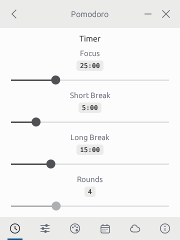

# Pomodoro

A small, themeable Pomodoro timer for the desktop, written in pure Rust with
[egui](https://github.com/emilk/egui). The layout follows
[Pomotroid](https://github.com/Splode/pomotroid).

| Timer | Running (Pomotroid theme) | Durations |
| --- | --- | --- |
|  |  |  |

| Activity | Activity (Catppuccin Mocha) | Themes |
| --- | --- | --- |
|  |  |  |

## Features

- Compact 360 × 480 card window with its own title bar.
- Focus, short break and long break rounds with adjustable lengths and round count.
- 23 built-in themes (Graphite, Pomotroid, Catppuccin, Tokyo Night, Dracula, Nord,
  Gruvbox, Rosé Pine, One Dark, Solarized, GitHub, Everforest, Kanagawa, Monokai Pro,
  Night Owl, Ayu, Synthwave) and an editor for creating your own.
- Chimes at the end of focus and break rounds, optional tick sounds, volume and mute.
- Activity heat map in the style of the GitHub contribution graph, shaded from
  the active theme's colours, with today / week / streak / all-time totals.
- Cloud sync of the focus history through a private GitHub Gist.
- Options: Always on Top, Auto-start Focus Timer, Auto-start Break Timer,
  Tick Sounds (focus / break), Desktop Notifications (focus end / break end),
  Minimize to Tray, Minimize to Tray on Close.
- Tray menu: show the window, start / pause, skip, quit. The timer keeps
  running, chiming and notifying while the window is hidden.

## Build and run

```bash
cargo run --release
```

Requires a recent stable Rust toolchain. On Linux, install the ALSA and
D-Bus development packages first (`libasound2-dev`, `libdbus-1-dev` on Debian/Ubuntu).

`Space` starts and pauses the timer.

## Cloud sync

Sync uses a private GitHub Gist, which is free with any GitHub account.

1. Open **Settings → Cloud Sync** and follow the link to create a personal
   access token with only the `gist` scope.
2. Paste the token and press **Sync Now**. The app finds the gist created by
   another device with the same token, or creates one.
3. From then on the app syncs by itself on launch and after every completed
   focus round.

History is stored per device and merged by taking the highest count each
device has reported for a day, so syncing repeatedly or from several machines
never double counts.

The token is stored in plain text in the config file (readable only by your
user account on macOS and Linux).

## Data

Settings and history live in the platform config directory under
`pomodoro-rs/` (`~/Library/Application Support/pomodoro-rs` on macOS):
`config.json` for settings and custom themes, `history.json` for completed
focus sessions.

## Platform notes

- **macOS**: fully supported and the platform this was developed and tested on.
- **Windows**: builds from the same code, including the tray; not yet tested.
- **Linux**: no tray icon yet, so the two tray options fall back to a normal
  minimize / close.

## License

MIT
