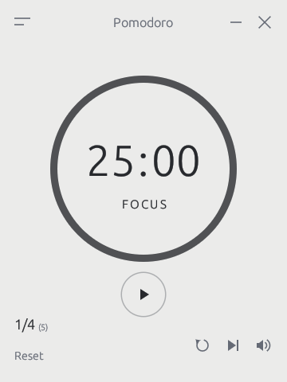
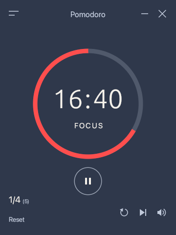
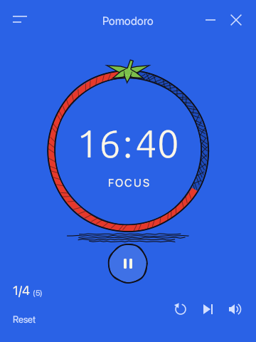
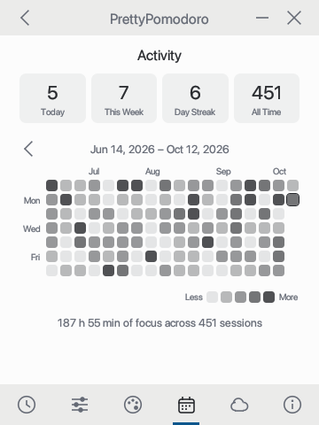
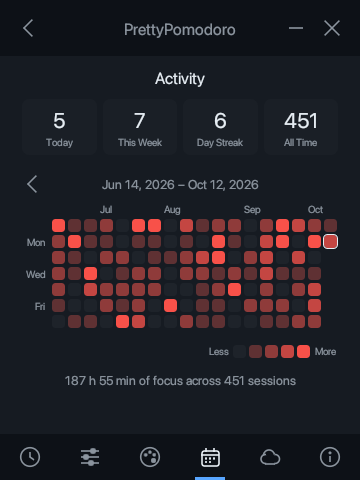
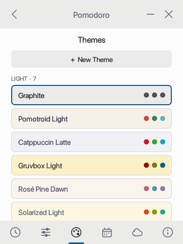

# Pomodoro

A small, themeable Pomodoro timer for the desktop, written in pure Rust with
[egui](https://github.com/emilk/egui). The layout follows
[Pomotroid](https://github.com/Splode/pomotroid).

| Timer | Running (Pomotroid theme) | Pencil Art (Tomato Sketch) |
| --- | --- | --- |
|  |  |  |

| Activity | Activity (Catppuccin Mocha) | Themes |
| --- | --- | --- |
|  |  |  |

## Features

- Compact 360 × 480 card window with its own title bar.
- Focus, short break and long break rounds with adjustable lengths and round count.
- 24 built-in themes in three families:
  - **Light** (7) and **Dark** (16): Graphite, Pomotroid, Catppuccin, Tokyo Night,
    Dracula, Nord, Gruvbox, Rosé Pine, One Dark, Solarized, GitHub, Everforest,
    Kanagawa, Monokai Pro, Night Owl, Ayu, Synthwave.
  - **Pencil Art**: Tomato Sketch, drawn like the app icon with ink outlines,
    hatching and a sketched tomato for the timer ring.
- A theme editor for your own themes, either flat light/dark or pencil art.
- Chimes at the end of focus and break rounds, optional tick sounds, volume and mute.
- Activity heat map in the style of the GitHub contribution graph, shaded from
  the active theme's colours, with today / week / streak / all-time totals.
- Private cloud sync of the focus history through a GitHub Gist.
- Options: Always on Top, Auto-start Focus Timer, Auto-start Break Timer,
  Tick Sounds (focus / break), Desktop Notifications (focus end / break end),
  Minimize to Tray, Minimize to Tray on Close.
- Tray menu: show the window, start / pause, skip, quit. The timer keeps
  running, chiming and notifying while the window is hidden.

## Download

[-000000?style=for-the-badge&logo=apple&logoColor=white)](https://github.com/ahmed-abd-elwahed/Pomodoro/releases/latest/download/Pomodoro-macos-universal.zip)
[](https://github.com/ahmed-abd-elwahed/Pomodoro/releases/latest/download/Pomodoro-windows-x64.zip)
[](https://github.com/ahmed-abd-elwahed/Pomodoro/releases/latest/download/Pomodoro-linux-x64.tar.gz)

The buttons point at the latest published release and start working once the
first release is published.

- **macOS**: unzip and move `Pomodoro.app` to Applications. The app is not
  notarized, so the first time right-click it and choose **Open**.
- **Windows**: unzip and run `Pomodoro.exe`. SmartScreen may ask for
  confirmation because the executable is unsigned.
- **Linux**: extract the archive and run `./install.sh`, or run `./pomodoro`
  directly. Sound needs ALSA (`libasound2`).

## Small and fast

Pomodoro is a single native Rust executable. It does not bundle a browser
engine or a language runtime.

| | Measured |
| --- | --- |
| Download (macOS universal zip, both architectures) | 9.8 MB |
| Executable (Apple Silicon) | 8.6 MB |
| Memory while open | 67 MB |
| CPU while idle | 0.0 % |
| Launch, render the window and exit | 0.45 s |
| Threads | 8 |
| Runtime dependencies to install | 0 |

Measured on an Apple M1 Max running macOS 26.5 with the release build:
memory, CPU and threads from `top` on the idle app with the timer paused;
launch time is the wall-clock time of a warm start that draws ten frames and
quits. The window only redraws when something changes, which is why an idle
timer uses no CPU.

## Build and run

```bash
cargo run --release
```

On macOS, build `Pomodoro.app`, install it into `/Applications` and open it with:

```bash
packaging/macos/install.sh
```

Requires a recent stable Rust toolchain. On Linux, install the ALSA and
D-Bus development packages first (`libasound2-dev`, `libdbus-1-dev` on Debian/Ubuntu).

`Space` starts and pauses the timer.

## Cloud sync

Sync uses a private (secret) GitHub Gist, which is free with any GitHub account.

1. Open **Settings → Cloud Sync** and follow the link to create a personal
   access token with only the `gist` scope.
2. Paste the token and press **Sync Now**. The app finds the gist created by
   another device with the same token, or creates one.
3. From then on the app syncs by itself on launch and after every completed
   focus round.

History is stored per device and merged by taking the highest count each
device has reported for a day, so syncing repeatedly or from several machines
never double counts.

The token is stored in plain text in the config file (readable only by your
user account on macOS and Linux).

## Data

Settings and history live in the platform config directory under
`pomodoro-rs/` (`~/Library/Application Support/pomodoro-rs` on macOS):
`config.json` for settings and custom themes, `history.json` for completed
focus sessions.

## Releases

`.github/workflows/release.yml` builds and tests the app on macOS, Windows and
Linux on every push to `main` and keeps the three packages as workflow
artifacts. Pushing a version tag also creates a **draft** GitHub release with
the packages attached; it becomes public only when published by hand.

```bash
git tag v0.1.0
```

```bash
git push origin v0.1.0
```

The icon files in `assets/` are generated from `assets/icon-source.webp` with
`cargo run --example make_icons`.

## Platform notes

- **macOS**: fully supported and the platform this was developed and tested on.
- **Windows**: builds from the same code, including the tray; not yet tested on
  a real machine.
- **Linux**: no tray icon yet, so the two tray options fall back to a normal
  minimize / close.
- Text uses the system UI font (San Francisco, Segoe UI, or Inter / Ubuntu /
  Noto / Liberation / DejaVu on Linux) and falls back to a bundled font, so
  every label renders on all three.

## License

MIT
