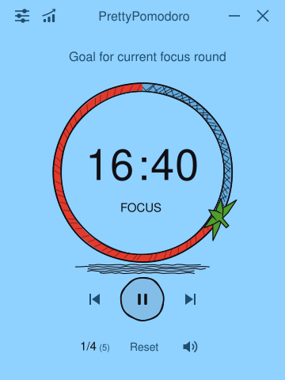
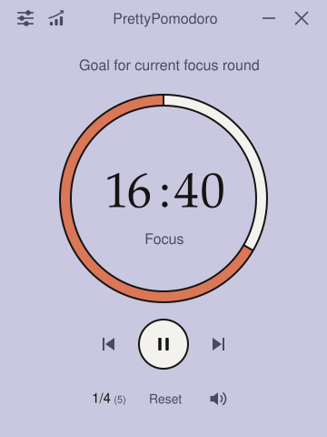
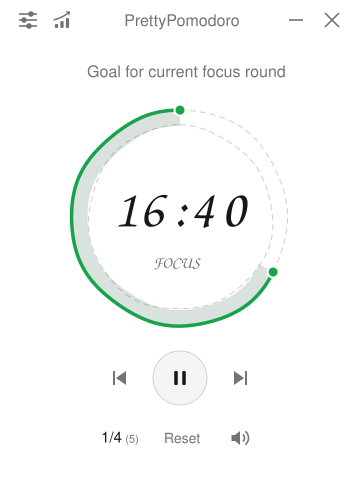
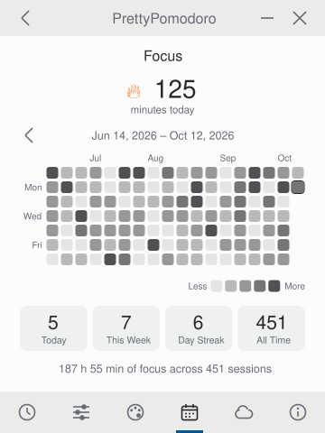
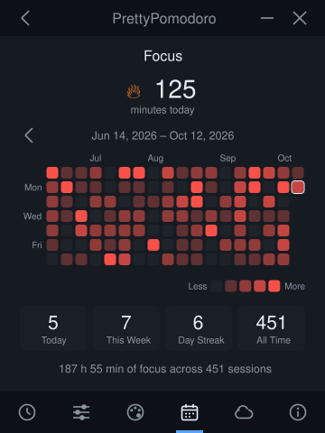
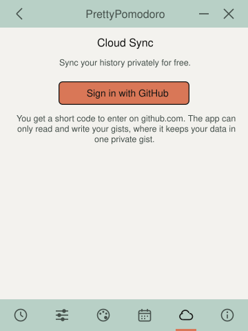

# PrettyPomodoro

A small, themeable Pomodoro timer for the desktop, written in pure Rust with
[egui](https://github.com/emilk/egui). The layout follows
[Pomotroid](https://github.com/Splode/pomotroid).

| Sky Sketch | Editorial Lavender | Sketch Light |
| --- | --- | --- |
|  |  |  |

| Activity (Editorial Sage) | Activity (Ink Well) | Cloud Sync (Sketch Blue) |
| --- | --- | --- |
|  |  |  |

## Features

- **Pretty themes.** 27 built-in themes in five families (Editorial, Sketch,
  Light, Dark and Pencil Art), plus an editor for making your own.
- **Progress calendar.** A heat map of every focus round you finish,
  with today, this week, streak and all-time totals.
- **Private and free data sync.** Your history syncs between your computers
  through a secret GitHub Gist on your own account, at no cost.
- **Set goals for each run.** Type a goal above the timer and tick it off in
  green when the round ends. Achieved goals are kept in a history, grouped by day.
- **Lightweight and efficient (built with Rust).** One small native executable
  with no bundled browser engine: a download under 10 MB that uses no CPU
  while idle.

## Download

[-000000?style=for-the-badge&logo=apple&logoColor=white)](https://github.com/PrettyPomodoro/PrettyPomodoro/releases/latest/download/PrettyPomodoro-macos-universal.zip)
[](https://github.com/PrettyPomodoro/PrettyPomodoro/releases/latest/download/PrettyPomodoro-windows-x64.zip)
[](https://github.com/PrettyPomodoro/PrettyPomodoro/releases/latest/download/PrettyPomodoro-linux-x64.tar.gz)

The buttons always download the latest published release.

- **macOS**: unzip and move `PrettyPomodoro.app` to Applications. The app is not
  notarized, so macOS blocks the first launch: press **Done**, open **System
  Settings → Privacy & Security**, scroll to Security and press **Open Anyway**.
  This is needed once.
- **Windows**: unzip and run `PrettyPomodoro.exe`. SmartScreen may ask for
  confirmation because the executable is unsigned.
- **Linux**: extract the archive and run `./install.sh`, or run `./prettypomodoro`
  directly. Sound needs ALSA (`libasound2`).

## Updates

The app checks GitHub for a newer release when it starts and twice a day while
it runs. When there is one it shows a desktop notification, and an **Update**
button appears under the title bar and on the About page.

- **macOS**: the button downloads the release, replaces the app in place and
  relaunches it. A round in progress is not carried over.
- **Windows** and **Linux**: the button opens the download for your platform
  in the browser; install it as before.

The check is one request to GitHub's public API and sends nothing about you.

## Small and fast

PrettyPomodoro is a single native Rust executable. It does not bundle a browser
engine or a language runtime.

| | Measured |
| --- | --- |
| Download (macOS universal zip, both architectures) | 9.8 MB |
| Executable (Apple Silicon) | 8.6 MB |
| Memory while open | 67 MB |
| CPU while idle | 0.0 % |
| Launch, render the window and exit | 0.45 s |
| Threads | 8 |
| Runtime dependencies to install | 0 |

Measured on an Apple M1 Max running macOS 26.5 with the release build:
memory, CPU and threads from `top` on the idle app with the timer paused;
launch time is the wall-clock time of a warm start that draws ten frames and
quits. The window only redraws when something changes, which is why an idle
timer uses no CPU.

## Build and run

```bash
cargo run --release
```

On macOS, build `PrettyPomodoro.app`, install it into `/Applications` and open it with:

```bash
packaging/macos/install.sh
```

Requires a recent stable Rust toolchain. On Linux, install the ALSA and
D-Bus development packages first (`libasound2-dev`, `libdbus-1-dev` on Debian/Ubuntu).

`Space` starts and pauses the timer.

## Cloud sync

Sync keeps the focus history in a private (secret) GitHub Gist, which is free
with any GitHub account.

1. Open **Settings → Cloud Sync** and press **Sign in with GitHub**.
2. The app shows a short code, copies it and opens github.com. Paste the code
   there and approve.
3. That's it. The app finds the gist created by another device on the same
   account, or creates one, and from then on syncs by itself on launch and
   after every completed focus round.

The text of the goals you tick off is not synced unless you switch on
**Sync Goal Texts**, which appears on the same page once you are signed in; it
then goes into a second file in the same gist.

The sign-in only grants access to gists. History is stored per device and
merged by taking the highest count each device has reported for a day, so
syncing repeatedly or from several machines never double counts.

The access token is stored in plain text in the config file (readable only by
your user account on macOS and Linux). **Sign Out** removes it.

Building your own copy: sign-in goes through a GitHub OAuth app with device
flow enabled; its client ID is the `GITHUB_CLIENT_ID` constant in `src/sync.rs`.

## Data

Settings and history live in the platform config directory under
`pomodoro-rs/` (`~/Library/Application Support/pomodoro-rs` on macOS):
`config.json` for settings and custom themes, `history.json` for completed
focus sessions and `goals.json` for the goals you have ticked off.

## Releases

`.github/workflows/release.yml` builds and tests the app on macOS, Windows and
Linux on every push to `main` and keeps the three packages as workflow
artifacts. Pushing a version tag also creates a **draft** GitHub release with
the packages attached; it becomes public only when published by hand.

```bash
git tag v0.1.0
```

```bash
git push origin v0.1.0
```

The icon files in `assets/` are generated from `assets/icon-source.webp` with
`cargo run --example make_icons`.

## Platform notes

- **macOS**: fully supported and the platform this was developed and tested on.
- **Windows**: builds from the same code, including the tray; not yet tested on
  a real machine.
- **Linux**: no tray icon yet, so the two tray options fall back to a normal
  minimize / close.
- Text uses the system UI font (San Francisco, Segoe UI, or Inter / Ubuntu /
  Noto / Liberation / DejaVu on Linux) and falls back to a bundled font, so
  every label renders on all three.

## Acknowledgements

Thank you to [Pomotroid](https://github.com/Splode/pomotroid) for inspiring this project.

## License

MIT
